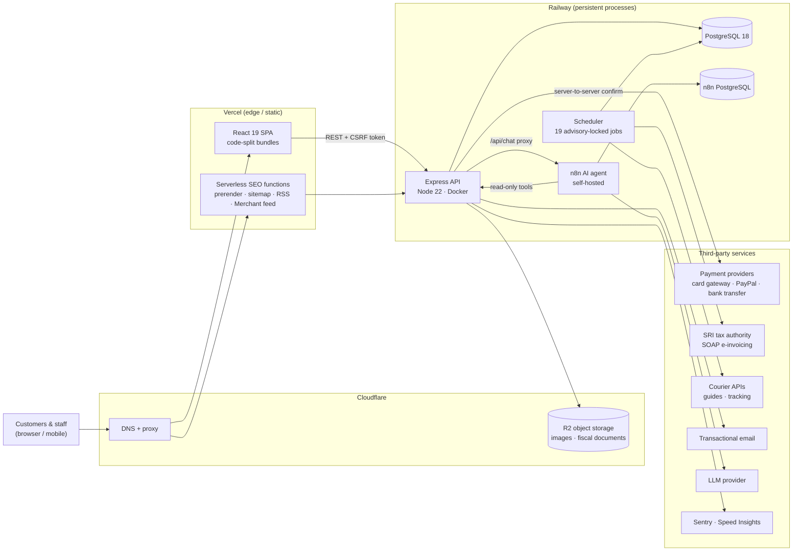

<div align="center">

# Proserpoc Commerce Platform

### Turning a WhatsApp lead-gen landing page into a transactional B2B/B2C commerce, invoicing and operations platform

**Case study · Private repository · Production system**

**[Visit the live site → proserpoc.com](https://proserpoc.com/)**


</div>

---

| | |
|---|---|
| **Role** | Sole engineer: architecture, full-stack development, DevOps and technical documentation |
| **Domain** | E-commerce (B2B wholesale + B2C retail), payments, electronic invoicing, logistics |
| **Client** | Ecuadorian manufacturer of biodegradable industrial-hygiene chemicals for the banana and agro-industrial sector |
| **Timeline** | ~11 weeks of intensive delivery · 835 commits · 88 merged pull requests |
| **Status** | Live in production at [proserpoc.com](https://proserpoc.com/), processing real orders, payments and tax-authority invoices |

---

## Table of Contents

1. [Executive Summary](#1-executive-summary)
2. [Privacy Notice](#2-privacy-notice)
3. [Architecture & Tech Stack](#3-architecture--tech-stack)
4. [Deep Dive: Technical Challenges & Solutions](#4-deep-dive-technical-challenges--solutions)
5. [Key Metrics & Impact](#5-key-metrics--impact)
6. [Engineering Practices](#6-engineering-practices)
7. [Skills Demonstrated](#7-skills-demonstrated)

---

## 1. Executive Summary

The client sold industrial chemicals through a marketing landing page that ended in a WhatsApp button. Every sale was negotiated by hand, nothing about the order was recorded, there was no online payment and no invoice was issued automatically. Wholesale buyers, who drive most of the revenue, had no self-service path at all.

I designed and built, end to end, a **production-grade transactional platform** that replaced that flow while keeping the brand and catalog:

- **A storefront** for both retail and wholesale buyers, with automatic volume-tier pricing, box-based selling, freight calculated by billable weight, an optional quotation flow for negotiated deals, PDF proformas, reviews, a blog, and an English version of the site.
- **A provider-agnostic payment layer** running three live payment channels (card gateway with an embedded checkout, PayPal, and verified bank transfers), with a fourth gateway ready to switch on through configuration.
- **Fully automated electronic invoicing** against Ecuador's tax authority (SRI): XML generation, XAdES-BES digital signing, SOAP submission, authorization polling, and PDF/XML delivery to the customer, all triggered by a confirmed payment.
- **A role-based back office** for sales reps, administrators, accountants and a super-admin: order pipeline, payment reconciliation, refunds, inventory, courier dispatch and tracking, accounting reports, and content management.
- **A self-hosted AI sales assistant** (n8n + LLM) with 16 read-only tools over the live catalog, with explicit cost controls.
- **The DevOps foundation**: containerized backend, split edge/persistent deployment, CI against a real PostgreSQL, zero-downtime migrations, error monitoring and an integration-health watchdog.

The live store scores **94 on mobile and 100 on desktop** for performance on PageSpeed Insights, with 100 for both SEO and Best Practices.

The project's guiding principle was **correctness where money and inventory are involved**. The system is built around nine non-negotiable invariants (zero trust in the frontend, payments confirmed only server-to-server, concurrency-safe stock, transactional webhook idempotency, and others) that are enforced in the database and in the service layer, not by convention.

---

## 2. Privacy Notice

> [!NOTE]
> **The source code for this project is proprietary and lives in a private repository.**
>
> The platform was built for a private commercial client and runs their live business: real customers, real payments and real tax filings. Publishing the code would expose business logic, operational details and integration specifics that belong to the client.
>
> This case study is written so a reviewer can judge the engineering **without** that exposure:
>
> - **No source code, credentials, infrastructure identifiers or customer data** appear in this document.
> - Code fragments are **illustrative pseudocode** of well-known patterns, not excerpts from the codebase.
> - Business figures (prices, volumes, revenue) are left out on purpose. The metrics below are **engineering metrics**, measured and recorded during development.
>
> I'm happy to walk through the architecture, the design records or selected parts of the code **in a live session**, within what my agreement with the client allows.

---

## 3. Architecture & Tech Stack

### 3.1 System Overview

<!--
  MERMAID DIAGRAM PLACEHOLDER
  Draft below reflects the production topology. Refine or replace as needed.
-->



**Why the topology is split.** The frontend and the SEO prerender functions are stateless, so they run on Vercel's edge network. The backend **can't** run serverless: the order-expiry job runs every 60 seconds holding a PostgreSQL advisory lock, and payment gateways need a stable callback URL. Both require a long-lived process, so the API, its scheduler and the AI agent run as persistent containers on Railway.

### 3.2 Tech Stack

| Layer | Technologies | Why |
|---|---|---|
| **Frontend** | React 19, TypeScript, Vite 6, Tailwind CSS 4, Motion, React Router 7, Lucide | Strong typing end to end; route-level code splitting; a utility-first design system with dark mode |
| **Backend** | Node.js 22, Express 4, TypeScript (ESM, `NodeNext`), Zod | A small, explicit HTTP layer; every input validated by a schema at the boundary |
| **Data** | PostgreSQL 18 (`citext`, `btree_gist`), Prisma 7 with the `pg` driver adapter | Relational integrity for money and stock; constraints that no ORM can express are written as raw SQL inside migrations |
| **Auth & security** | JWT (`jose`) in `httpOnly` cookies, Argon2id, Google OAuth2, TOTP 2FA with recovery codes, Helmet, CSRF synchronizer tokens, `express-rate-limit` | Sessions that can't be read by scripts, rotating refresh tokens with reuse detection, layered rate limiting |
| **Payments** | Embedded card checkout, PayPal, verified bank transfers, a second card gateway ready to enable | One contract behind every provider (see Challenge 2) |
| **Fiscal** | XAdES-BES signing (`node-forge`, SRI signer), SOAP client, `fast-xml-parser`, PDFKit, QR codes | Legally valid e-invoices and credit notes, signed and submitted by the server |
| **Documents & media** | Sharp (WebP pipeline), PDFKit (invoice PDFs, proformas), ExcelJS / DOCX (exports), S3 SDK for R2 | Generated on the server so the output is consistent and auditable |
| **AI** | n8n (self-hosted), LLM provider, 17 versioned workflows | A shopping assistant grounded in live catalog data through tools |
| **Observability** | Pino structured logs, Sentry (browser + Node), Vercel Speed Insights, integration-health monitor | Know when something breaks, including the things that fail without making noise |
| **DevOps** | Docker (multi-stage), Docker Compose, GitHub Actions, Vercel, Railway, Cloudflare (DNS, R2, Email Routing) | Reproducible builds, migrations gated before deploy, CI against a real database |
| **Testing** | Vitest 4: unit tests plus integration tests against a freshly migrated PostgreSQL | Covers what mocks can't: sessions, transactions, row ownership |

### 3.3 Architectural Invariants

Nine rules govern the whole codebase. Breaking one doesn't produce a visible bug. It produces **overcharged customers, phantom inventory or leaked personal data**, so each one is enforced structurally:

| # | Invariant | Enforced by |
|---|---|---|
| 1 | **Zero trust in the frontend.** Price, stock, tax, shipping and totals are always recalculated by the backend | The quote stores a fingerprint; confirmation recalculates from the database and rejects any difference |
| 2 | **Payments are confirmed server-to-server, never by browser redirect** | The return page only polls; the state change happens on a signed webhook or a server-side confirmation |
| 3 | **Concurrency-safe inventory** | Conditional `UPDATE … WHERE stock >= qty` inside a transaction; never read-then-write |
| 4 | **Every stock reservation resolves exactly once** | A `stock_reserved` flag is cleared with a guarded update; whoever arrives second affects 0 rows |
| 5 | **Canonical lock order** | Multi-row stock updates always run sorted by variant ID, which prevents deadlocks |
| 6 | **Transactional webhook idempotency** | The event record and the state change it causes commit in the same transaction |
| 7 | **Immutable orders** | Orders snapshot price, tax, product name and address at checkout |
| 8 | **Security baseline** | HTTPS, CSP, strict CORS, Argon2id, Zod, secrets only in the environment |
| 9 | **Data minimization (Ecuador's data-protection law, LOPDP)** | Append-only consent records, self-service data export and account deletion |

---

## 4. Deep Dive: Technical Challenges & Solutions

### Challenge 1 · A checkout that can't oversell, double-charge or leak inventory

**Context.** Wholesale customers often order on rural mobile connections where a slow response leads to a second tap. Stock is limited and shared between retail and wholesale. A naive "check stock, then create order" checkout would create duplicate orders, reserve the same units twice, and return stock twice when orders expire.

**What I built.** A three-step checkout (**quote → confirm → pay**), where each step has one responsibility:

1. **Quote.** Calculates prices from the volume tiers, tax rounded per line, and freight from the **billable weight** (the greater of actual and volumetric weight), and checks hazmat compatibility with the carrier rate. It persists a quote that expires after 15 minutes. The cart never stores prices, so the customer is always charged what they were shown.
2. **Confirm.** Runs inside a single transaction and requires an `Idempotency-Key`:
   - The order is **inserted first, and the `UNIQUE` violation is caught**. I didn't use "look it up, then create it", because that pattern *is* the race condition: two simultaneous requests both find nothing.
   - Totals are **recalculated from scratch** and compared with the quote. If they differ, the API returns `409` with the new breakdown, so a customer is never charged an amount they didn't see.
   - Stock is reserved with a conditional decrement, **always sorted by variant ID** so concurrent checkouts can't deadlock:

     ```sql
     -- illustrative pattern
     UPDATE product_variants
        SET stock_quantity = stock_quantity - :qty
      WHERE id = :variant_id AND stock_quantity >= :qty;
     -- 0 rows affected → ROLLBACK → 409 "insufficient stock"
     ```
3. **Pay.** The order holds a 30-minute reservation. The gateway session is deliberately set to expire **at 25 minutes**, so the gateway stops accepting payment *before* the system can release the inventory. One configuration value turns "paid after the stock was released" from a routine case into a rare one.

**Exactly-once resolution.** A reservation can end in four ways: paid, failed, expired or cancelled. Every path clears `stock_reserved` with `WHERE stock_reserved = true`, so whichever path arrives second affects zero rows and does nothing. A background job sweeps abandoned orders in **batches of 50 with bounded concurrency** under a **PostgreSQL advisory lock**. Before releasing stock it asks the gateway whether a late payment arrived, and if so it reuses the *same* `pending → paid` transition the webhook uses. That transition logic exists in one place only.

**Why this design.** Each guarantee lives in the database: a unique constraint, a conditional update, a guarded flag. Application code alone can't guarantee these things under concurrency, and the database can. The advisory lock also makes horizontal scaling safe: a second instance skips the run instead of returning stock twice.

**Outcome.** Integration tests run against a real PostgreSQL in CI and exercise the double-click, the cross-account order access and the reservation lifecycle. Duplicate orders and double releases are prevented by constraints, not by hoping requests don't collide.

---

### Challenge 2 · A provider-agnostic payment layer that withstands real gateways

**Context.** Ecuador's payment landscape is fragmented, and the client needed to launch quickly with one gateway while keeping the option to switch. Each provider behaves differently: one has **no signed webhook** and **automatically reverses** a charge if it isn't confirmed within five minutes, another uses signed notifications, and bank transfers need manual verification.

**What I built.**

```
   E-COMMERCE (orders · cart · stock)   ← doesn't know who is charging
            │
     PaymentService      ← the ONLY path to paid / failed / expired
            │
     PaymentProvider     ← shared contract: create charge, query status, map states
            │
  ┌─────────┼───────────┬───────────────┐
 Card     PayPal    Bank transfer   Card gateway #2
 gateway                (manual)    (ready, config switch)
```

- A provider can only **authenticate, create a charge, query its status and translate its states** into `approved / rejected / pending`. It can never touch stock or order status. If a provider needed to, the design would be broken.
- Each provider declares its **flow** (`redirect`, `embedded` or `manual`) and advertises its payment destinations ahead of time, so the checkout can ask "card or app?" *before* the order exists without hard-coding provider knowledge into the frontend.
- **Webhook idempotency done correctly.** The naive approach ("insert the event; if it's a duplicate, return 200") **loses payments**: if the process dies between the insert and the state change, the retry is thrown away as a duplicate. In my design the event row and the state change commit **in the same transaction**, with `SELECT … FOR UPDATE` serializing concurrent retries. Signatures are validated *before* the transaction opens, so forged payloads can't consume legitimate event IDs. Failure counters are written in a **separate transaction after the rollback**, because otherwise the rollback that triggers the retry would also erase the counter.
- For the gateway without webhooks, the browser return lands on a **backend endpoint**, not a React page, so the confirmation call goes out within the five-minute window even on a slow phone.

**Hardening from my own security audit.** I ran an offensive review of the whole money path. The most important finding: an `approved` status only says *a charge happened*, not that *this order was paid*. A partial approval, a charge in another currency, or a transaction attached through the public return URL could all have marked an order as paid. I added the **charged amount to the status contract** and compare it with the order total in the single path that leads to `paid`. A mismatch doesn't reject the money: it sends the order to a **reconciliation queue** for a person to decide.

**Integration lessons I documented.** Validating against live accounts exposed behavior that no documentation mentions. For example, one gateway returns an HTML `500` when Node's `fetch` sends the default `Accept-Language: *`, and the confirmation endpoint expects a numeric transaction ID instead of the opaque payment ID that the prepare call returns. Each of these is pinned by a test and recorded in the design notes.

**Outcome.** Switching gateways is **a single environment variable**. Checkout, cart, reservations and order states stay untouched. Three channels run in production and a fourth is ready.

---

### Challenge 3 · Automated electronic invoicing against the tax authority (SRI)

**Context.** Ecuadorian law requires an electronic invoice for every sale, transmitted **immediately** (a 2025 resolution removed the old four-day window). An invoice issued to an anonymous "final consumer" can't be voided or corrected afterwards. Before this project, invoices were issued by hand outside the system.

**What I built.** An asynchronous fiscal pipeline triggered by a confirmed payment:

```
order marked paid ──enqueue (after commit)──▶ fiscal_documents (pending)
                                                 │
                                         issue-invoices job
                                                 │
     number → build XML → XAdES-BES signature → submission → authorization
                                                 │
                       RIDE (PDF) + XML ──▶ R2 storage + email to customer
```

It also covers credit notes, withholding records, accounting reports and an accountant role. All SRI catalogs live in one module annotated with their table numbers from the official technical spec, so a new spec version has one place to review.

**Problems that only appeared in production, and how I handled them:**

| Problem | Root cause | Solution |
|---|---|---|
| An invoice silently lost after a two-second network outage | A failed submission left the document in a state the job never picked up again | Failed sends go back to `pending` and **keep their sequential number**, as the spec requires; the job gives up after 5 attempts |
| Risk of duplicate submission on retry | A `fetch failed` doesn't tell you whether the SRI received the document | Before resubmitting a reused number, the job **asks for the authorization first** and collects the existing result |
| Intermittent `ERR_TLS_CERT_ALTNAME_INVALID` | The tax authority's load balancer sometimes answers with a `302` to a bare IP | The SOAP client **never follows redirects** (a signed fiscal document must not reach an unverified host). It retries twice inside the same 30-second budget and leaves a clear entry in the document's log |
| Invoices dated the wrong day | The container runs in UTC and Ecuador is UTC−5: any sale after 7 p.m. was dated tomorrow, including inside the access key | A dedicated date module with tests for the evening window and for month and year boundaries |
| `ERROR SECUENCIAL REGISTRADO` on every submission | Sequence numbers started at zero while the business had already issued invoices elsewhere | The sequence is seeded from the last number the SRI already has on record, through a migration |
| Opaque `fetch failed` messages in the admin log | Node's `undici` hides the real cause in nested `error.cause` | The cause chain is unwrapped up to three levels and the system error code is added, so the operator can read it without server logs |

**Why this design.** Fiscal submission runs **outside the payment transaction**. A slow or unavailable tax authority must never block a sale, and a sale must never lose its invoice. A durable queue with idempotent, resumable steps gives both guarantees.

**Outcome.** Tested end to end against the SRI test environment with real orders, then put into production. Invoicing went from a manual task after each sale to **zero manual steps** from payment to the invoice in the customer's inbox.

---

### Challenge 4 · Web performance: from 59 to 94 on mobile, and a 313 KB first visit

**Context.** The store scored 100 for SEO but **59 for mobile performance**, with an **11.6 s Largest Contentful Paint** on PageSpeed. Most visitors in the target market browse on mid-range phones over mobile data, and Core Web Vitals affect search ranking.

**What I found and fixed.** I profiled before changing anything and found six root causes:

1. **A full-screen intro video** covered the page for up to 3 s on *every* visit, so the LCP couldn't happen. I gave the client the options with their trade-offs, and we removed it.
2. **65 MB of product photos.** Images were delivered at about 47× the pixels the cards could display. I built a **build-time image pipeline** (Sharp → WebP at 480/960/1440 px) with a manifest that stores real dimensions. Every `` now gets `width` and `height`, which also removed the layout shift (CLS).
3. **A 1.2 MB "SVG" logo** that was really a base64 bitmap. Replaced with a 6 KB WebP.
4. **One 1.4 MB JavaScript bundle.** Every screen, including the full admin panel, downloaded on the home page. I added **route-level code splitting**, kept the landing page eager on purpose (a lazy import would add a round trip right on the LCP path), and grouped the admin panel into a single chunk so navigating inside it doesn't trigger a download on every click.
5. **Render-blocking third-party fonts.** About 1.3 s on mobile. I self-hosted variable fonts limited to Latin subsets.
6. **The hardest one: the home page was never prerendered.** Fixing the first five got desktop to 96, but mobile stayed behind. Measuring in production showed the home HTML arrived **empty**. On Vercel the filesystem is checked *before* rewrites, so the build's `index.html` silently shadowed the SEO prerender function, and it had done so for eleven delivery phases. Crawlers that don't run JavaScript got no content at all. Lighthouse still showed SEO 100 because it does run JavaScript. I fixed it with a Vite plugin that moves the shell out of the way, plus **server-seeded hydration**, so React reuses the prerendered content instead of replacing it with a loading state.

**Outcome (cold visit to the home page):**

| | Before | After |
|---|---|---|
| JavaScript (gzip) | 388 KB | **181 KB** |
| Product images | 9,958 KB | **34.5 KB** |
| Logo | 1,174 KB | **5.7 KB** |
| **Total transfer** | **~11.5 MB** | **313 KB** |
| PageSpeed performance (mobile) | 59 | **94** |
| PageSpeed performance (desktop) | 69 | **100** |
| PageSpeed best practices | 92 | **100** |
| LCP (desktop) | 3.9 s | **1.2 s** |

Current PageSpeed Insights scores for the home page (October 2026):

| | Performance | Accessibility | Best Practices | SEO |
|---|---|---|---|---|
| **Mobile** | 94 | 93 | 100 | 100 |
| **Desktop** | 100 | 93 | 100 | 100 |

I then added **real-user monitoring** (Vercel Speed Insights) with a privacy filter. One-time tokens in URLs, such as email verification and password resets, are stripped before any beacon leaves the browser. Route patterns are computed so the dashboard groups pages by template, and a test fails CI if a new route isn't registered.

---

### Challenge 5 · DevOps: safe deploys, real CI and production you can see

**Context.** The frontend (Vercel) and the backend (Railway) are built **independently**, so a change that breaks one side wasn't noticed until that deploy failed, or until it failed in production.

**What I built.**

- **CI on every branch and PR** (GitHub Actions) as the required status check for `main`: type checks for both layers, the full unit-test suite, both builds, and then **migrating a fresh PostgreSQL 18 from zero** before running the integration suite (registration, cart, quotation, checkout confirmation, double-submit, cross-account access, account deletion). Migrating from an empty database is a test in itself: it proves a new environment can always be created.
- **Docker multi-stage image** on `node:22-bookworm-slim`. I chose it over Alpine on purpose, because Argon2's native binaries are built for glibc. The runtime stage installs **only the backend workspace's production dependencies**, which leaves the entire frontend toolchain out of the image. It runs as a non-root user.
- **Migrations run once, before the new version starts**, as a pre-deploy step. If a migration fails, the deploy stops and **the previous version keeps serving traffic**. A half-applied migration with new code on top is the expensive failure mode, and this design avoids it.
- **Health checks that reflect reality.** `/health` returns `503` when the database is unreachable, so the platform pulls the instance out of rotation. Healthy and broken are kept distinct.
- **Horizontal-scale readiness.** All 19 background jobs (order expiry, invoicing, payment reconciliation, courier guide purchase and tracking, abandoned-cart reminders, scheduled blog publishing, AI translation, and more) serialize through `pg_try_advisory_xact_lock`. A second replica skips the run instead of duplicating the work.
- **An integration-health watchdog** that every 15 minutes checks what breaks *quietly*: invoices waiting at the tax authority, outbound email, job heartbeats, unreconciled payments, object-storage reachability. It's exposed to an external uptime monitor behind a token. On purpose, it isn't wired to the platform health check, so a single expired certificate can't take every instance offline.
- **Sentry** with separate browser and server projects, so errors can be filtered by layer. PII sending is disabled, and turning on browser reporting is tied to a privacy-policy update, as the data-protection law requires.

**Outcome.** 88 pull requests merged with CI as a hard gate, schema changes that deploy without manual steps, and a production environment that reports its own failures.

---

### Challenge 6 · An AI sales assistant with a cost ceiling

**Context.** The client wanted a conversational assistant to answer product, pricing and coverage questions around the clock. The first version ran on a paid hosted n8n subscription, lost the conversation whenever the visitor changed pages, and had **no lower bound on LLM spend**.

**What I built.**

- **Self-hosted n8n** on the existing Railway project with **its own PostgreSQL**, separate from the store's. The agent writes one execution row per message, which shouldn't compete for I/O with checkout transactions, and the two systems' backups shouldn't be tied together. I rejected the popular queue-mode template (5 services) for a single instance (about half the monthly cost), keeping a documented upgrade path that doesn't touch any workflow.
- **The browser never calls the agent directly.** `POST /api/chat` goes through the backend, which validates and rate-limits it. When the agent isn't configured, the endpoint returns `503`: the store keeps selling with the assistant switched off.
- **16 read-only tools** (catalog search, product and price simulation, services, product reviews, Google reviews, shipping coverage by province and parish, blog). All **17 workflows are versioned in the repo** and deployed through the n8n API with scripts that keep existing credentials.
- **Conversation continuity at zero token cost.** The widget is mounted once, outside the router. The browser stores only the conversation ID and the rendered messages, while the agent's memory lives in PostgreSQL, so it survives redeploys. Sessions end after 10 minutes through a **signed, time-stamped identifier** rather than in-process state, and then hand off to a human advisor.
- **Context awareness with a contained injection surface.** About 20 tokens of page and cart context travel with each message, and they're sanitized because the visitor controls the URL.

**Cost engineering:**

| Change | Effect |
|---|---|
| Catalog search took query and category parameters and returned 8 trimmed records instead of 24 full ones | Removed the agent's largest token leak and improved answer relevance |
| Context window reduced from 10 to 6 turns | Every turn carries tool outputs, not only text |
| Static "how does the store work?" shortcuts answered without calling the model | Zero LLM cost for questions whose answer never changes |
| A **daily per-IP limit** added next to the 15-minute burst limit | The burst limit stops loops; the daily limit caps the monthly bill |

**Outcome.** The assistant gained six capabilities and context across pages, while its token usage per conversation **went down, not up**. Infrastructure moved from a monthly SaaS subscription to a service on the existing hosting.

---

### Also in scope

- **Authentication & sessions.** Short-lived JWT plus a rotating, hashed refresh token with reuse detection and a grace window. Role and status are re-read on every request, so deactivating an account takes effect immediately. TOTP two-factor authentication with recovery codes, Google OAuth, and an opt-in "keep me signed in".
- **Authorization.** Permission-based, not role-based, mounted at the router level. Ownership checks sit **inside the `WHERE` clause** and return `404` rather than `403`, so the API never confirms that someone else's resource exists.
- **Uploads.** File type is detected from the **bytes**, not from the extension or `Content-Type`. SVG is excluded and the server chooses object keys.
- **Database integrity.** 200+ `CHECK` constraints and a **GiST exclusion constraint** that stops shipping-weight brackets from overlapping within a zone, written as raw SQL because no ORM can express them.
- **Logistics.** Courier API integration for guide purchase and tracking, a direct-dispatch carrier option, per-package freight, wholesale shipping thresholds, and an "arrange delivery" fallback.
- **Identity verification.** Tax-ID lookup against the public taxpayer registry, with a commercial provider as fallback.
- **Compliance (LOPDP).** Append-only consent records, a full personal-data export, account deletion, and a GA4 consent banner.
- **SEO & growth.** Serverless prerendering for every public route, sitemap, Google Merchant feed, RSS, structured data, managed redirects, a review system with Google integration, back-in-stock alerts and abandoned-cart reminders.
- **Content & i18n.** A block-based blog editor with scheduling and drag-and-drop, AI-assisted article import and translation, and a fully translated English storefront.

---

## 5. Key Metrics & Impact

### Business impact

| Before | After |
|---|---|
| Sales negotiated by hand on WhatsApp, with no record in any system | Self-service checkout for retail **and** wholesale, plus an optional quotation flow that keeps negotiated deals inside the system |
| No online payment | **3 live payment channels**, and a 4th ready behind a config switch |
| Invoices issued by hand after each sale | **Fully automated** SRI e-invoicing: payment → signed invoice → customer's inbox |
| No inventory control | Real-time, concurrency-safe stock with reservations and an audit trail of stock movements |
| One generic contact channel | Role-based back office for **4 staff roles**, plus a 24/7 AI assistant with a human hand-off |

### Performance

| Metric | Before | After | Change |
|---|---|---|---|
| Home page transfer (cold visit) | ~11.5 MB | 313 KB | **−97%** |
| Initial JavaScript (gzip) | 388 KB | 181 KB | **−53%** |
| Product image library | 65.4 MB | 0.67 MB | **−99%** |
| PageSpeed performance (mobile) | 59 | 94 | **+35 pts** |
| PageSpeed performance (desktop) | 69 | 100 | **+31 pts** |
| PageSpeed best practices | 92 | 100 | **+8 pts** |
| PageSpeed SEO | 100 | 100 | Kept at the maximum |
| LCP (desktop) | 3.9 s | 1.2 s | **−69%** |
| Prerendered-page FCP / CLS | — | 272 ms / 0.0017 | Measured after the fix |

### Engineering scale & quality

| Metric | Value |
|---|---|
| Commits / merged pull requests | **835 / 88**, in about 11 weeks |
| Data model | **94** Prisma models, **42** enums, **78** versioned migrations |
| Automated tests | **193** test files, **~2,000** test cases (unit + integration against real PostgreSQL) |
| Backend surface | **22** route modules, **19** scheduled background jobs |
| Third-party integrations | Payment providers, tax authority (SOAP), couriers, object storage, email, OAuth, LLM agent, analytics, error monitoring |
| Design documentation | **140+** incremental delivery phases, each with a written record of decisions, trade-offs and lessons learned |

### Reliability outcomes

- **Duplicate orders and double stock releases are prevented at the database level** (unique constraints, guarded updates, advisory locks), not by application logic alone.
- **No payment is confirmed by the browser.** Every state change is verified server-to-server and checked against the order total.
- **No invoice can be silently lost.** Failed submissions are retried without duplication and without burning sequence numbers.
- **Failed migrations never reach users.** Deploys stop and the previous version keeps serving.

---

## 6. Engineering Practices

- **Docs as code.** Every delivery phase has a design record: why it exists, what was decided and rejected, the invariants it introduces, and what it deliberately leaves out. The record is written so the next engineer (or my future self) doesn't repeat a mistake that was already paid for.
- **Invariants over conventions.** When a rule matters, it's enforced by a constraint, a single code path or a test that fails CI. It doesn't rely on people remembering it.
- **Measure, then change.** Every optimization starts with a baseline and ends with a measurement in production, including the regressions that lab tools can't see.
- **Fail safe, degrade gracefully.** A missing integration returns `503` and the store keeps selling. An amount that doesn't match goes to a person for reconciliation. Nothing fails silently.
- **Phase branches merged through pull requests**, with CI as the required check on `main`.

---

## 7. Skills Demonstrated

| Area | Evidence in this project |
|---|---|
| **System design** | Split edge/persistent topology, provider-agnostic payment contract, async fiscal pipeline |
| **Backend engineering** | Transactional integrity, idempotency, concurrency control, background job orchestration |
| **Database engineering** | PostgreSQL constraint design (CHECK, UNIQUE, GiST exclusion), advisory locks, zero-downtime migrations |
| **Payments & fintech** | Webhook idempotency, amount reconciliation, multi-gateway integration, refunds |
| **Regulatory integration** | XAdES-BES signing, SOAP integration with a government API, tax-law-driven design, data-protection compliance |
| **Frontend engineering** | React 19, code splitting, SSR-style prerendering with hydration seeding, accessibility fixes (WCAG contrast, touch targets) |
| **Web performance** | Core Web Vitals diagnosis, image pipelines, bundle optimization, real-user monitoring |
| **DevOps** | Docker, GitHub Actions, Vercel, Railway, Cloudflare, health checks, observability |
| **Security** | Offensive self-audit, session hardening, CSRF, IDOR prevention, CSP, safe uploads |
| **AI integration** | Tool-based LLM agent, self-hosting, cost engineering, prompt-injection awareness |
| **Communication** | 140+ design records, user manuals for each staff role, decisions written down with their reasoning |

---

<div align="center">

**Interested in the details?** I'm glad to walk through the architecture, the trade-offs or the code in a technical interview.

**Dalton Cornejo** · Full-Stack & Backend Engineer

[](https://www.linkedin.com/in/dalton-cornejo/)
[](https://github.com/Dev-DsC)
[](mailto:daltonsteve22@gmail.com)
[](https://proserpoc.com/)

</div>
